# Snake Quest

**Snake, but every level brings a new twist.** A retro campaign of 40 levels built with [Pyxel](https://github.com/kitao/pyxel):
hunt and be hunted, shoot turrets, slide over ice, crawl through dark caves, steer through gravity wells, push crates
in a clockwork workshop, and face eight bosses on the way.

[](https://github.com/godaup/snake/actions/workflows/ci.yml)


[](LICENSE)

<p align="center">
  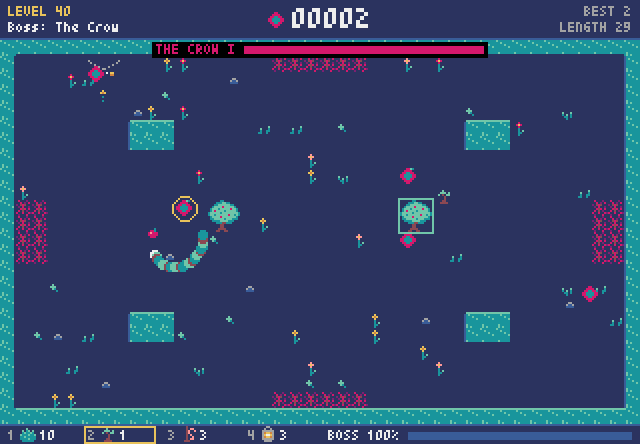
</p>

## Features

- **35 story levels in 7 arcs, plus a bonus arc.** Each level adds at most one new mechanic and later ones combine
  them, so the game keeps teaching you something new.
- **8 bosses**, each with its own phases: a hunger that eats you from the inside, a pack leader, a fortress core behind
  a ring of turrets, a rival snake, a spider queen in the dark, a mothership, a clockwork, and a crow.
- **Weapons**: a gun, spread shot, ricochet, mines, laser, homing shots, flares and a tractor beam.
- **Terrain with rules**: portals, thorns, ice, mirrored floor, webs, cave-ins, airlocks, pressure plates, conveyor
  belts, keys and locks.
- **The Keeper**, a bonus arc where the snake moves on its own and you are the gardener's hand: plant hedges, trees,
  lures and lanterns to keep it alive.
- **Four difficulties** (Easy, Medium, Hard, Nightmare), separate highscores for each arc and difficulty, and an
  overview map with checkpoints at the start of every arc.
- **Original chiptune music** for every arc, written as text scores and compiled into Pyxel sounds.
- Keyboard, mouse and gamepad; snake colour palettes; crisp, smooth and retro screen filters; fullscreen.

## Screenshots

| | | |
|:-:|:-:|:-:|
| 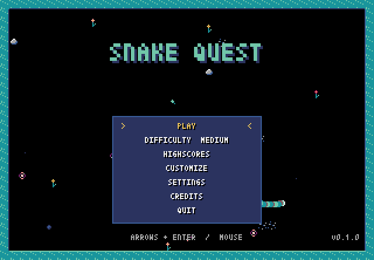 | 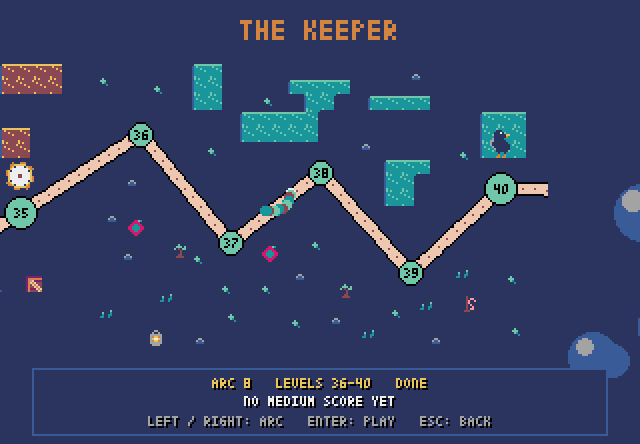 | 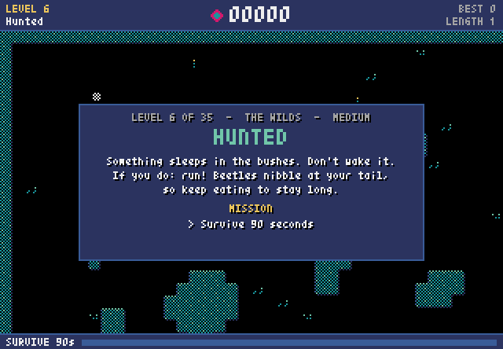 |
| Main menu | The overview map | Every level starts with its mission |
| 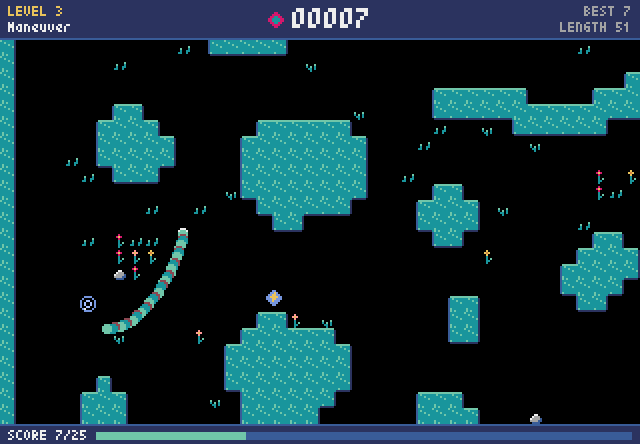 | 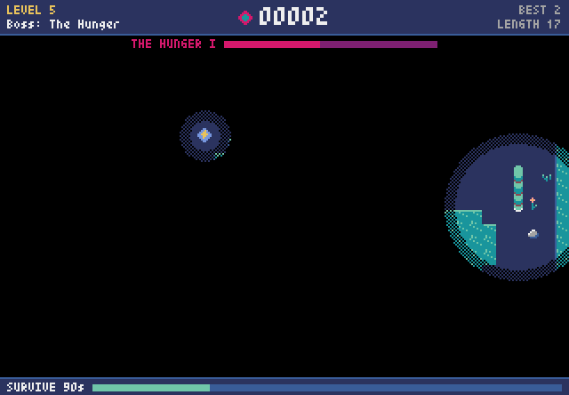 | 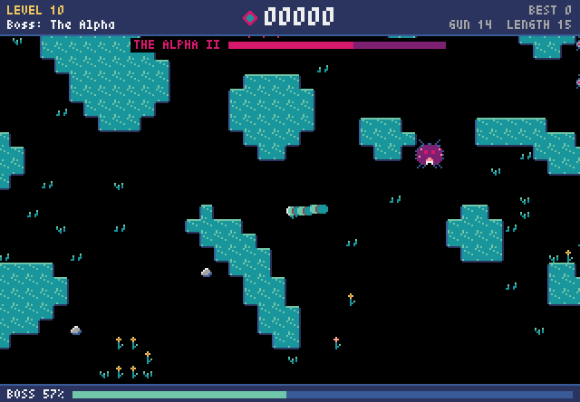 |
| The Garden: a scrolling level with portals | The Hunger: starving in the dark | The Wilds: the Alpha and its pack |
| 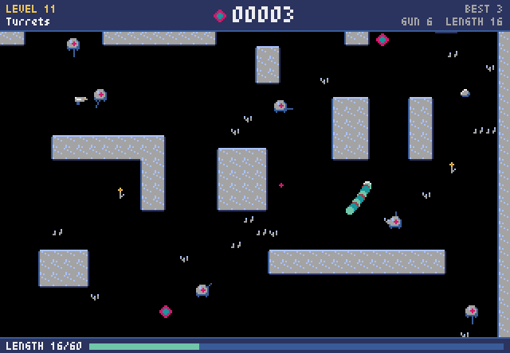 | 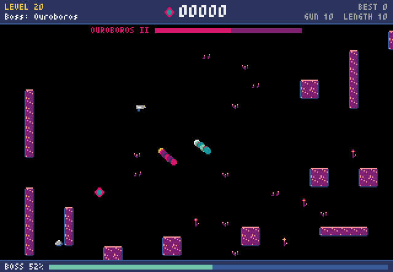 | 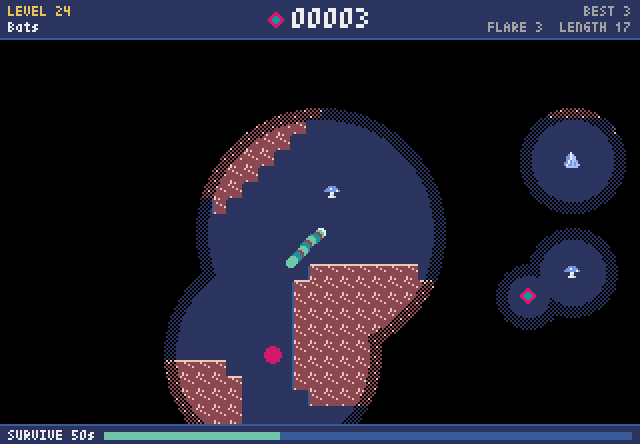 |
| The Fortress: turrets | Ouroboros: a rival snake | The Caves: bats wake in the light |
| 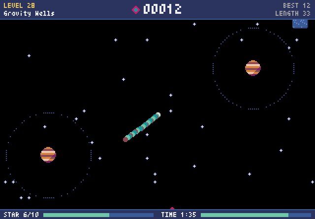 | 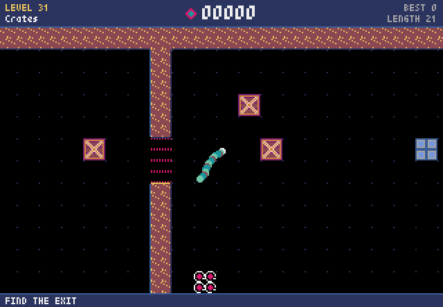 | 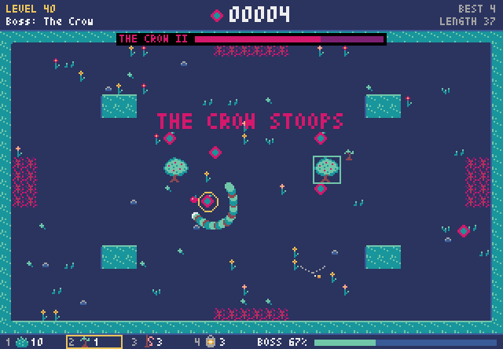 |
| Space: gravity wells | The Workshop: crates and plates | The Keeper: the Crow |

## The campaign

| Arc | Levels | Boss |
|-----|--------|------|
| 1. The Garden | Classic, Yummy, Maneuver, The Maze | The Hunger |
| 2. The Wilds | Hunted, Armed, Prey, Burrows | The Alpha |
| 3. The Fortress | Turrets, Swarm, Ice, Minefield | The Core |
| 4. Ouroboros | Trail, Mirror, Armored, Gauntlet | Ouroboros |
| 5. The Caves | Webs, Moles, Collapse, Bats | The Brood Mother |
| 6. Space | Airlock, Zero-G, Gravity Wells, Asteroids | The Mothership |
| 7. The Workshop | Crates, Pressure Plates, Keys, Conveyors | The Clockwork |
| Bonus: The Keeper | Hedges, Orchard, Lures, Lanterns | The Crow |

Finishing an arc opens the next one on the overview map; The Keeper opens after the story's end. What each level
is about, and what is still planned, is in the [roadmap](ROADMAP.md).

## Install and play

Snake Quest needs Python 3.10 or newer. On Linux, Pyxel also needs the system SDL2 library
(e.g. `sudo apt install libsdl2-2.0-0`).

```bash
git clone https://github.com/godaup/snake.git
cd snake
pip install .
snake-quest               # or: python -m snake_quest
```

| Option | |
|--------|-|
| `--level N` | start (and restart) at a level, by number or name, e.g. `--level hunted` |
| `--difficulty NAME` | `easy`, `medium`, `hard` or `nightmare` for this run (the menu's choice is saved) |
| `--scale N` | window size factor |
| `--mute` | no music or sound |
| `--debug` | show collision points, the hidden path and what is under the mouse |
| `--preview FILE.png` | render the whole `--level` to an image instead of playing |

### Controls

| | Keyboard | Gamepad |
|-|----------|---------|
| Steer | ← → | D-pad |
| Fire (when you carry a weapon) | Space | |
| Pause | P or Esc | Start |
| Menus | arrow keys or WASD, Enter, Esc to go back; or the mouse | D-pad, A, B |
| After a game over | R restart, M menu, Q quit | A restart, B menu |
| The Keeper's hand | the mouse (left places, right lifts, wheel or 1-4 chooses a tool), or the arrow keys, Space and X | D-pad, A, B, shoulder buttons |

Highscores, settings and the arcs you have finished are saved in Pyxel's per-user data folder
(`~/.pyxel/godaup/snake-quest/profile.json`).

## Development

```bash
pip install -e . --group dev      # editable install with pytest and ruff (needs pip >= 25.1)
pytest                            # the tests; `pytest -m slow` also checks each level's win rate per difficulty
ruff check . && ruff format --check .
```

Levels are YAML files in [`src/snake_quest/levels/`](src/snake_quest/levels) with their layouts in Pyxel resource
files, one per arc (`pyxel edit src/snake_quest/resources/garden.pyxres`). Most mechanics are data-driven: goals,
tiles, entities, weapons and bosses are registries that level files refer to by name. A bot plays the levels in the
tests to prove that every one can be won, and to keep the difficulties apart.

The [`tools/`](tools) folder has the level design and content tools:

| Tool | |
|------|-|
| `draft_garden.py`, `draft_maze.py`, `draft_workshop.py`, `draft_keeper.py` | generate or decorate level layouts (caves, fortresses, temples, stations, mazes, puzzles) |
| `solve_workshop.py` | check and solve the Workshop's crate puzzles |
| `compose_theme.py`, `compose_music.py`, `compose_effects.py` | compile the text scores into the game's music and sound effects |
| `balance.py` | the bot's win rate per level and difficulty |
| `readme_media.py` | render the screenshots and the clip above from the real game |
| `mcp_game.py` | run the game headlessly for the [pyxel-mcp](https://github.com/kitao/pyxel-mcp) server |
| `audio_stress.py` | check music switching against Pyxel's audio thread |

[`CLAUDE.md`](CLAUDE.md) describes the architecture in detail, and [`docs/`](docs) holds the design documents of the
later arcs.

## Credits

Game design and code by Patrick Godau. Built with [Pyxel](https://github.com/kitao/pyxel) by Takashi Kitao and
[OmegaConf](https://github.com/omry/omegaconf).

## License

[MIT](LICENSE)
